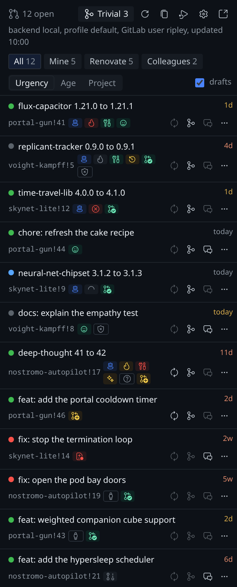
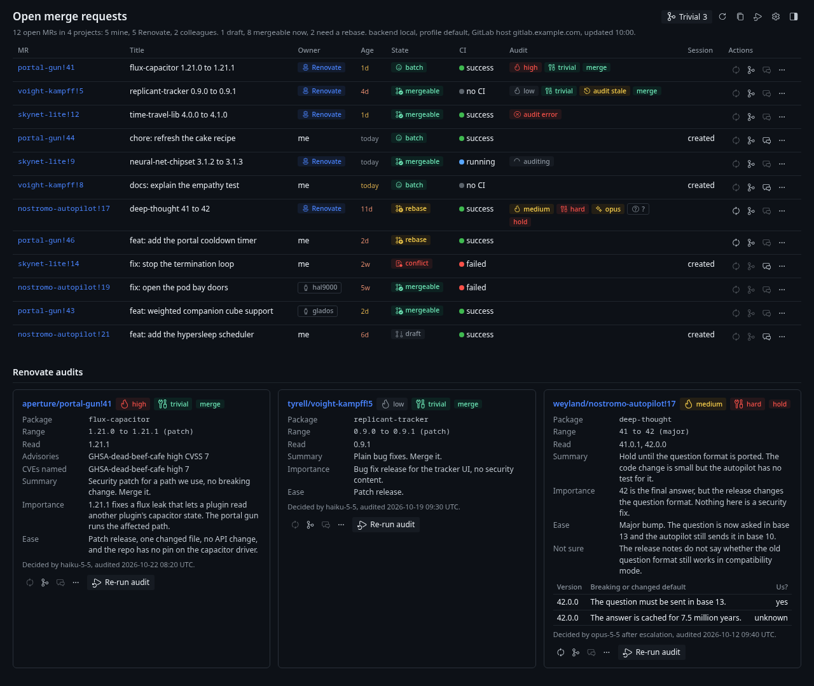

# Mergeable for Hermes

Your open GitLab merge requests in one place, inside Hermes Desktop: a tab stacked with Files, a
full page, rebase and merge behind a confirm dialog, a trivial batch, and a rating of every
Renovate bump (what it fixes, how hard it is to merge, merge or hold).



The screenshots in this repository show fictional merge requests from
[docs/fixtures/example.json](docs/fixtures/example.json).

## Features

- **One list.** Open MRs of every project you are a member of, sorted by urgency, filtered by
  All, Mine, Renovate and Colleagues. A row has two lines: pipeline dot, title and age, then the
  MR reference, state chips and icon buttons.
- **Age in working days.** The label is calendar time (`3d`, `2w`); the colour counts Monday to
  Friday minus the Hamburg public holidays.
- **Merge behind a confirm dialog.** The dialog is the go for that one MR. The backend re-reads
  the MR, rebases at most once, waits for a green head pipeline and merges with the head sha.
- **Trivial batch.** One button lands every MR that matches your trivial rules, one at a time,
  and stops at the first failure.
- **Renovate audits.** Code fetches release notes, changelog sections and security advisories;
  a tool-less model call only rates them. Importance, ease, verdict and confidence show as chips.
- **Notifications.** Seven events, each a toggle, native while Hermes is in the background.
- **Colleagues stay read-only.** Their MRs show every write disabled.



## Requirements

- Hermes Agent 0.21.5 or newer with Hermes Desktop.
- `glab` installed and logged in to your GitLab host. The plugin uses your own login and stores
  no token.
- For Renovate audits: a Hermes model route for the `anthropic` provider.

## Install

```sh
hermes plugins install Senci/hermes-mergeable --enable
```

Then, in Hermes Desktop, open **Capabilities > Plugins** and switch on **Mergeable**. The desktop
half of a plugin package starts switched off. Restart the backend (or the app) once so the routes
under `/api/plugins/mergeable/` mount. Set `gitlab_host` under Settings, Plugins, Mergeable, Agent
settings if your GitLab is not the default one.

Open the pane with `mod+alt+m` (Ctrl+Alt+M on Linux and Windows, Cmd+Option+M on macOS), the
sidebar row **Mergeable**, or the command palette entry "Show Mergeable". Step by step:
[docs/tutorial/getting-started.md](docs/tutorial/getting-started.md).

## Documentation

| Kind | Read this when you want to |
|---|---|
| [Tutorial](docs/tutorial/getting-started.md) | install it and find your way around the pane |
| [How-to guides](docs/how-to/) | merge an MR, land the trivial batch, hold a Renovate package, re-audit, change settings, update these docs |
| [Reference](docs/reference/) | look up routes and payloads, settings keys, chips and icons, notification events |
| [Explanation](docs/explanation/architecture.md) | understand how it is built, and [why](docs/explanation/decisions.md) |

## Development

`desktop/plugin.js` is built from `desktop/src/` and the [hermes-plugin-ui-kit](https://www.npmjs.com/package/hermes-plugin-ui-kit) package (`sh scripts/rebuild.sh`
in this directory installs both into the gitignored `.build/`; esbuild 0.28.2) and committed.

```sh
python3 -m unittest discover -s plugins/mergeable/tests -v   # backend
node plugins/mergeable/tests/desktop.test.mjs                # desktop half, stand-in SDK
node plugins/mergeable/scripts/docs-shots.mjs --check --out "$(mktemp -d)"   # docs screenshots
```

The desktop test runs the committed bundle in plain node against a stand-in SDK, a small stand-in
React and a stand-in backend (`tests/standin/`). Refresh the screenshots after any desktop change:
[docs/how-to/update-docs.md](docs/how-to/update-docs.md).
