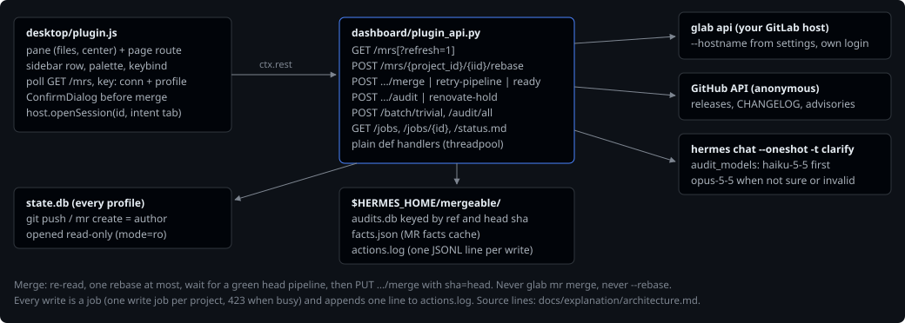

# How it works

Mergeable has two halves in one package. The desktop half draws the pane, the page and the
settings and holds no GitLab access. The backend half owns the data and every write, and reaches
three outside things: GitLab through `glab`, GitHub for release notes, and a tool-less Hermes
model call for the Renovate rating.

The figure's labels, with the line each one is true at:

| Box or label | What it says | Source |
|---|---|---|
| desktop/plugin.js | pane in the Files zone (`dock: files, center`) and the page route | [`index.js:41`](../../desktop/src/index.js), `:42` |
| | sidebar row, palette entry and keybind, one action id | `index.js:43`, `:44`, `:47` |
| | the poll of `GET /mrs`, query key with connection and profile | [`data.js:26`](../../desktop/src/data.js), `data.js:23` |
| | the REST helper is the plugin context's `ctx.rest` | [`state.js:19`](../../desktop/src/state.js) |
| | merge and trivial batch sit behind `ConfirmDialog` | [`view.js:49`](../../desktop/src/view.js), `view.js:76` |
| | open the session that made an MR in a new tab | `data.js:147` |
| dashboard/plugin_api.py | every route, as plain `def` handlers run by the thread pool | [`plugin_api.py:52`](../../dashboard/plugin_api.py) to `:119`, `:13` |
| glab api | argv lists only, `--hostname` from settings, never a shell | [`mg_glab.py:41`](../../dashboard/mg_glab.py), `:62` |
| GitHub API | releases, changelog files, advisories, no token | [`mg_audit.py:101`](../../dashboard/mg_audit.py), `:118` |
| hermes chat --oneshot -t clarify | the model call, no tools; models from `audit_models` | `mg_audit.py:335`, `:47`, `:437` |
| $HERMES_HOME/mergeable/ | `audits.db` keyed by ref and head sha | [`mg_store.py:21`](../../dashboard/mg_store.py), `:33` |
| | `facts.json`, the per-MR facts cache | [`mg_collect.py:88`](../../dashboard/mg_collect.py) |
| | `actions.log`, one line per write | [`mg_actions.py:125`](../../dashboard/mg_actions.py) |
| state.db (every profile) | author markers `git push`, `glab mr create`; opened `mode=ro` | [`mg_sessions.py:19`](../../dashboard/mg_sessions.py), `:29` |
| footer: merge | re-read, one rebase, wait for green, `PUT .../merge` with the sha | `mg_actions.py:196` to `:269`, `:255` |
| footer: one write job per project | the 423 | [`mg_jobs.py:54`](../../dashboard/mg_jobs.py), [`mg_service.py:196`](../../dashboard/mg_service.py) |

## The model is not the Hermes plugin LLM facade

The audit does not use `ctx.llm`: that lives on the agent-side plugin context and is not handed
to a dashboard router. The backend starts a child instead:
`hermes -p <profile> chat --query-file <0600 file> --oneshot -Q -m <model> --provider anthropic --safe-mode --source tool -t clarify`.
`-t clarify` is the form with no tools, which matters because release notes are third-party
text; `--source tool` keeps the call out of your Sessions list. Code fetches every release note,
changelog section and advisory first, so the model only rates what it is given.

## One poll, one list

1. The desktop half polls `GET /mrs` every poll interval (default 60 s), with connection and
   profile in the query key, so a switch of gateway or profile never shows the other backend's
   data.
2. The first collect lists the projects you are a member of and their open MRs, then reads one
   detail per MR. Later collects re-read a detail only for an MR whose head or update time moved,
   whose pipeline was not green, or that is new; merge status, conflicts and draft always come
   from the list call. Facts persist in `facts.json`, so a restart starts warm. Within 45 s the
   same snapshot answers again.
3. The backend attaches the audits from `audits.db` and the session of each branch from the
   `state.db` of every profile (opened read-only), works out what each button may do (`can`) and
   which MRs are in the trivial batch, and sorts by urgency.
4. A Renovate MR whose head has no finished audit is queued for one (when `auto_audit` is on).

## One write, one job

A click on Merge or Rebase posts `{expected_sha}` to the route. The route answers 202 and a
`job_id` at once; a job thread does the work and writes steps the desktop half polls every 3 s.
Before anything is written the backend re-reads the MR and refuses if the head moved (409), the
MR is a colleague's (403) or another write job runs on the project (423). Merge never calls
`glab mr merge`, never uses `--rebase` and never sets `merge_when_pipeline_succeeds`: it polls the
head pipeline itself and then merges with the head sha, so what lands is the commit the dialog
showed.

## What stays local

- GitLab is reached with your own `glab` login; no token is read, stored or passed in argv.
- The backend writes to GitLab only for the actions you start, each behind a dialog or a menu
  item, and logs each write.
- The desktop half sends no text to a model and never writes into a chat: MR titles are
  third-party data and no code path leads to a composer.

Why it is built this way: [decisions.md](decisions.md).
