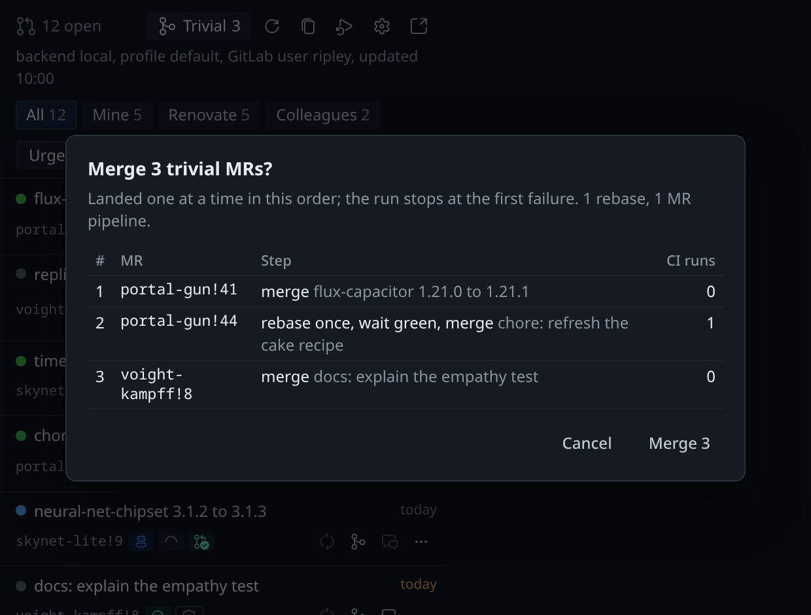

# Land the trivial batch

Use this to merge every small, safe MR in one go. The backend lands them one at a time, in a
fixed order, and stops at the first failure.

## What counts as trivial

An MR is in the batch when it passes every rule below (settings in
[reference/settings.md](../reference/settings.md)):

- Never a draft, a colleague's MR, a red pipeline or a conflict, and never in a project on
  `trivial_never_projects`.
- State `mergeable`, or `need_rebase` when `trivial_allow_rebase` is on (default).
- A **Renovate** MR: its audit is finished, the verdict is `merge`, the ease is `trivial`, and
  when `trivial_require_sure` is on (default) the audit is `sure`.
- **Your own** MR (when `trivial_own` is on, default): the title starts with one of
  `trivial_title_prefixes` (default `chore`, `ci`, `docs`, `build`) followed by a colon or a
  parenthesis, and it changes at most `trivial_max_files` files (default 10).

The rule that keeps an MR out is in its `trivial.miss` field, for example `audit verdict hold`
or `title prefix not in the list` (`GET /mrs`, see [reference/api.md](../reference/api.md)).

## Steps

1. Look at the header button **Trivial (N)**. N is the size of the batch; with 0 the button is
   disabled and its tooltip says so.
2. Click it. One dialog lists every MR in landing order, with the step each one takes and the
   extra pipelines it costs.

   

3. Click **Merge N**. Exactly the listed MRs and head shas are sent. If anything changed since
   the dialog opened (a new MR qualifies, one no longer does, a head moved) the backend refuses
   with 409 and names the difference; open the dialog again.
4. Watch the job strip under the header. The row of the MR being worked on shows its step.

## Order, rebases and cost

The order is by project, mergeable MRs first, then by MR number. In a project that merges with
fast-forward only, every merge makes the next MR in that project behind the target, so the
second and later MRs of such a project take one rebase each and start one more pipeline. The
dialog shows the totals ("1 rebase, 1 MR pipeline"). A Renovate MR is rebased through Renovate's
own rebase box.

The run stops at the first step that fails. The MRs after it are not touched: their steps read
`not attempted: the batch stopped at <ref>` and they stay open.

## Related

- One MR at a time: [merge-one-mr.md](merge-one-mr.md).
- Change the rules: [settings-and-notifications.md](settings-and-notifications.md).
