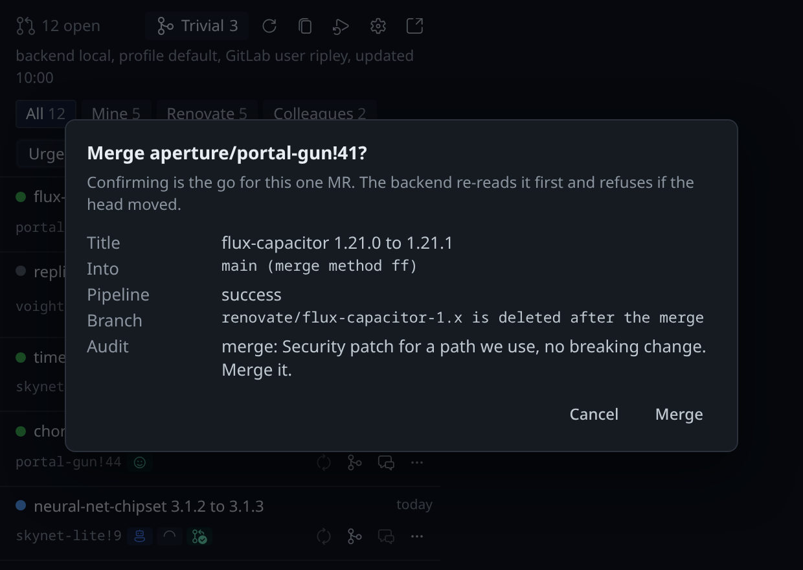

# Merge one MR

Use this to merge a single MR of your own, or a Renovate MR, from the pane. Colleagues' MRs are
read-only: every write button on them is disabled.

## Steps

1. Find the row. The **Merge** button (`git-merge` icon) is enabled when the backend says the MR
   can be merged now or after one rebase. When it is disabled, hover it: the tooltip is the
   reason (`Draft`, `Conflict`, `Pipeline failed`, and so on).
2. Click **Merge**. A dialog opens with the title, the target branch and merge method, the
   pipeline state, whether the source branch is deleted afterwards, and the audit verdict of a
   Renovate MR.

   

3. Click **Merge** in the dialog. That click is the go for this one MR and nothing else.
4. Watch the job. A strip under the header shows the running job and the step that touches the
   row (`reread`, `rebase`, `wait-green`, `merge`). The list refreshes once when the job ends,
   and a toast says whether it is `done`, `failed` or `stopped`.

## What the backend does

[`merge_flow`](../../dashboard/mg_actions.py) in this order:

1. Re-reads the MR from GitLab. It stops with `head moved` when the head sha differs from the one
   the row showed (`expected_sha`), so you never merge a commit you did not see.
2. Refuses a draft, a conflict and a colleague's MR.
3. If the MR needs a rebase, rebases once: for your own MR with a server-side rebase, for a
   Renovate MR by ticking Renovate's own rebase box in the description. A second rebase is never
   started; the job fails instead.
4. Waits for the head pipeline to succeed. It polls every 20 s and gives up after
   `merge_wait_minutes` (default 45). A project without CI does not wait.
5. Merges with `PUT .../merge` and `sha=<head>`, and removes the source branch when
   `delete_source_branch` is on (default).

It never runs `glab mr merge`, never rebases through `--rebase` and never sets
`merge_when_pipeline_succeeds`. The dialog text says the same: the backend refuses if the head
moved.

## When it does not start or stops

| You see | Meaning |
|---|---|
| Merge button disabled, tooltip `Draft` | Mark the MR ready first (More menu, Mark ready) |
| Tooltip `Conflict` | Resolve the conflict in the branch; Mergeable does not resolve conflicts |
| Toast with 409 | The head moved after the row was drawn (refresh and look at the new commit), or the MR is a draft or has conflicts |
| Toast with 403 | A colleague's MR: read only |
| Toast with 423 | Another write job runs on that project. The write buttons of the project are disabled while it runs |
| Job `failed`, detail `pipeline failed` | The head pipeline did not go green. Retry it (More menu, Retry failed pipeline), then merge again |
| Job `stopped` | The backend stopped on purpose, for example the head moved during the wait |

Every write appends one line to `$HERMES_HOME/mergeable/actions.log` with the action, the MR, the
sha before and after, and the result.

## Related

- Several small MRs at once: [land-trivial-batch.md](land-trivial-batch.md).
- The routes behind the buttons: [reference/api.md](../reference/api.md).
