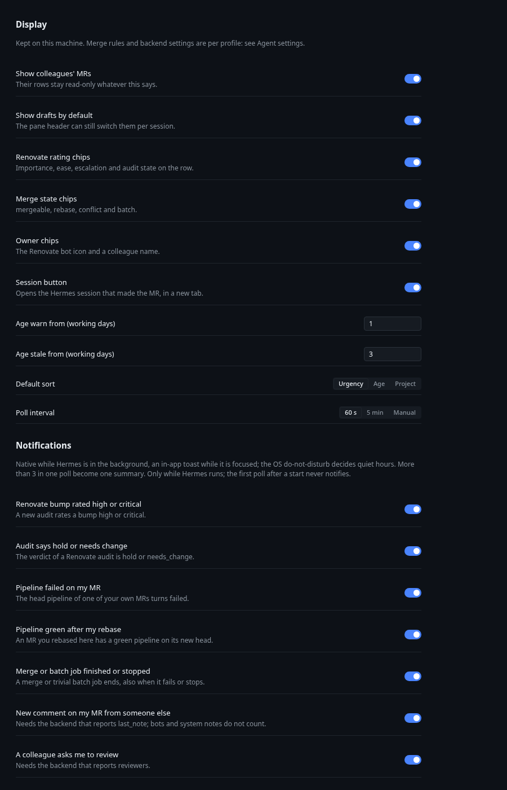
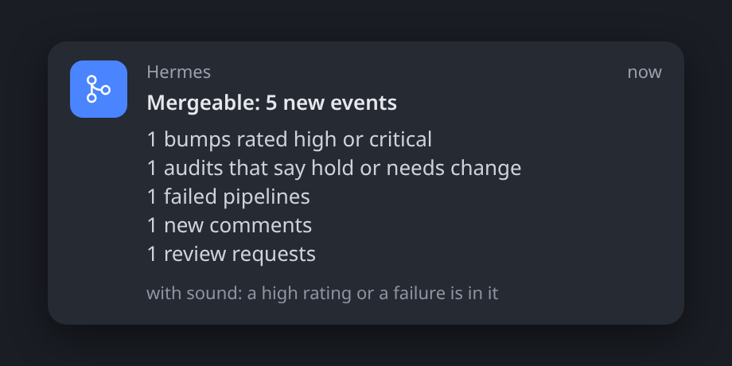

# Change settings and notifications

Mergeable has two kinds of settings, in two places, because two different parts read them.

| Where | What | Kept in |
|---|---|---|
| Settings, Plugins, Mergeable, **Display** | what the pane and page show, the age limits, sort, poll interval, notifications | this machine (the plugin's storage) |
| Settings, Plugins, Mergeable, **Agent settings** | GitLab host, which projects, trivial rules, merge behaviour, audit models | the profile (`plugins.entries.mergeable.settings` in its config) |

The backend enforces the second kind, so it lives with the profile. Every key and default is in
[reference/settings.md](../reference/settings.md).

## Open the settings

Click the cog in the pane header, or open **Settings > Plugins > Mergeable** yourself.

## Change what the list shows

On the Display page switch colleagues' MRs, drafts by default, the three chip groups (rating,
state, owner) and the session button on or off. The two age limits are in working days: amber
from the first, orange from the second (default 1 and 3, compared with `>=`). Default sort and
poll interval (60 s, 5 min, manual) are there too. A change applies at once; the pane header can
still switch drafts and sort for the current session.

## Change the trivial rules or the GitLab host

On the Agent settings page edit the keys, for example `trivial_title_prefixes` or
`trivial_max_files`. The backend reads them on every request, so no restart is needed: the batch
the header button counts follows the new rules on the next poll or refresh. `gitlab_host` is the
host `glab` is called against; `include_groups` and `exclude_projects` narrow which projects are
listed.

## Notifications

Seven events, each a toggle at the bottom of the Display page, all on by default:

- a Renovate bump rated high or critical
- an audit that says hold or needs change
- a failed pipeline on your own MR
- a green pipeline on an MR you rebased from here
- a merge or batch job that finished or stopped
- a new comment on your MR from someone else
- a colleague asking you to review

While Hermes is in the background, a notification is native (`ctx.os.notify`); while it is
focused, you get an in-app toast with a **Show** action. Clicking either brings the Mergeable tab
forward with that MR expanded (a filter that hides it is switched to All).

That picture is a mock of the summary the plugin builds when more than three events arrive in one
poll; the desktop environment draws the real notice. Details, including which events are silent
and how repeats are avoided: [reference/notifications.md](../reference/notifications.md).

Things to know:

- Events come from the difference between two polls, so they fire only while Hermes runs, and the
  first poll after a start never notifies.
- No quiet hours: the operating system's do-not-disturb decides. The host can also mute all plugin
  notifications (Settings, Notifications).
- The comment and review events need a backend that reports `last_note` and `reviewers`.
  Bot and system notes never count as a comment from someone else.
- Poll interval `Manual` stops the poll, and with it the events.
