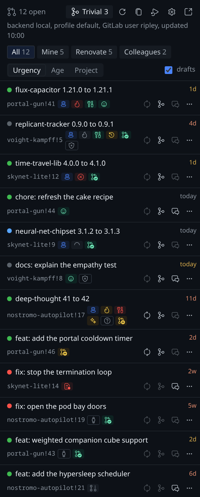

# Chips and icons

Icons are codicons drawn by the host (set 0.0.45); the plugin bundles no font. In the pane a chip
is its icon only: the tooltip carries the name and the reason, the colour carries the level. The
page shows icon and label. The map is `CHIP_ICON` in [`desktop/src/model.js`](../../desktop/src/model.js);
the rules that decide when a chip shows are `chipsOf` in [`desktop/src/logic.js`](../../desktop/src/logic.js).

## Chips

| Chip | Codicon | Tone | Shown when |
|---|---|---|---|
| Draft | `git-pull-request-draft` | muted | the MR is a draft |
| Renovate | `robot` | accent | owner is `renovate` |
| Colleague | `person` | outline | owner is `other`; the page labels it with the author |
| Importance | `flame` | red for critical and high, amber for medium, muted below | the MR has an audit |
| Ease | `tools` | green for trivial and easy, amber for medium, red for hard | the MR has an audit |
| Escalated | `sparkle` | amber | the audit was decided by a stronger model after a first model was not sure |
| Not sure | `question` | outline | the audit confidence is not `sure` |
| Audit queued or running | `loading`, spinning | muted | `audit_state` is `queued` or `running` |
| Audit stale | `history` | amber | the head moved since the audit |
| Audit failed | `error` | red | the last audit run failed |
| In the trivial batch | `smiley` | green | the MR is in the batch (replaces Mergeable) |
| Mergeable | `git-pull-request-done` | green | state `mergeable`, not in the batch |
| Needs rebase | `git-pull-request-create` | amber | state `need_rebase` |
| Conflict | `git-pull-request-new-changes` | red | the MR has conflicts and does not merely need a rebase (one constant, `CONFLICT_ICON`) |
| No CI | `workspace-untrusted` | outline | the MR has no pipeline |

Rating chips follow the `chipRatings` setting, state chips `chipState`, owner chips `chipOwner`.
Draft and No CI always show. Mergeable, batch, rebase and conflict are not shown on a draft.

## Buttons

A button never reuses a chip glyph.

| Button | Codicon | Where |
|---|---|---|
| Rebase | `sync` | row |
| Merge | `git-merge` | row |
| Open session | `comment-discussion` | row |
| More | `ellipsis` | row |
| Open the full page | `link-external` | pane header |
| Refresh | `refresh` | header |
| Copy status | `copy` | header |
| Re-audit all | `debug-rerun` | header |
| Settings | `settings-gear` | header |
| Sidebar row | `git-merge` | sidebar |

## More menu

| Item | Codicon |
|---|---|
| Open in GitLab | `link-external` |
| Open pipeline | `run-all` |
| Retry failed pipeline | `debug-rerun` |
| Copy branch name, Copy glab view command | `copy` |
| Mark ready | `check` |
| Re-run audit | `debug-rerun` |
| Add Renovate hold rule | `shield` |

## Age colour

The age label is calendar time (`today`, `3d`, `2w`, `3mo`). Its colour counts working days:
amber from `ageWarn`, orange from `ageStale`. Working days are Monday to Friday minus the Hamburg
public holidays, computed from the Easter date, so no yearly table needs updating: New Year, Good
Friday, Easter Monday, 1 May, Ascension, Whit Monday, 3 October, 31 October (Reformation Day),
25 and 26 December. The tooltip names the date, the calendar days and the working days.

## A new icon name

A name from a newer codicon release than the host's renders as an empty box. Check the name
against the host's `node_modules/@vscode/codicons/dist/codicon.css` (`.codicon-<name>:before`)
before it goes into `CHIP_ICON`; `scripts/docs-shots.mjs` draws the shots with that font, so an
empty box shows up in the pane shot.
