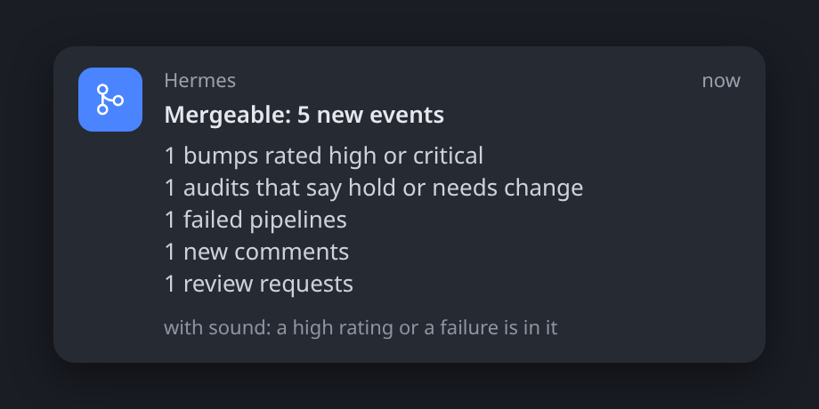

# Notification events

Seven events, each a toggle on the Display settings page, all on by default. The code is
[`desktop/src/notify.js`](../../desktop/src/notify.js) (delivery) and
[`desktop/src/logic.js`](../../desktop/src/logic.js) (`mrEvents`, `jobEvents`, `takeFresh`,
`messagesFor`); the event table is `EVENTS` in [`desktop/src/model.js`](../../desktop/src/model.js).

| Event | Setting | Fires when | Toast kind | Silent |
|---|---|---|---|---|
| Bump rated high or critical | `notifyBump` | a Renovate audit rates importance high or critical, and the previous poll did not already show that for the same head | warning | no |
| Audit says hold or needs change | `notifyAudit` | the verdict becomes `hold` or `needs_change` for a head | warning | yes, unless the audit rates importance high or critical |
| Pipeline failed on my MR | `notifyPipelineFailed` | the head pipeline of your own MR turns `failed`, or the head moved and it is failed | error | no |
| Pipeline green after my rebase | `notifyPipelineGreen` | an MR of yours that a rebase, merge or batch job rebased from this window has a green pipeline on its new head | success | yes |
| Merge or batch job ended | `notifyJob` | a merge or batch job turns `done`, `failed` or `stopped` (the toast kind is the event's, whatever the outcome) | success | yes when done, no when it failed or stopped |
| New comment on my MR | `notifyComment` | `last_note` of your own MR is newer, and its author is neither you nor a bot | info | yes |
| A colleague asks me to review | `notifyReview` | you appear in `reviewers` of a colleague's MR where you did not before | info | yes |

The comment and review events need a backend that reports `last_note` and `reviewers`; against an
older backend they stay quiet. A bot is a name with `bot` as a word of its own (set off by `_`, `.` or `-`, as in
`group_<id>_bot_<hash>`) or a name starting with `renovate`; a system note is never a comment.

## How a poll becomes a notice

- Events come from the difference between two consecutive `GET /mrs` polls and from `GET /jobs`
  (read only while the job or green-pipeline event is on). They fire only while Hermes runs.
- The first poll of a backend and profile after a start is the baseline and never notifies.
- Each event has a key (`<ref>:bump:<sha>`, `<ref>:audit:<sha>`, `<ref>:pipeline-failed:<sha>`,
  `<ref>:pipeline-green:<sha>`, `<ref>:comment:<note time>`, `<ref>:review:<sha>`,
  `job:<id>:<state>`). Announced keys are stored in the plugin's storage (newest 400), so a
  restart does not repeat an event. A muted event is still remembered, so switching it on later
  does not replay old news.
- More than 3 events in one poll become one summary titled `N new events`, one line per kind. It
  is silent only when every event in it is.
- While Hermes is focused the notice is an in-app toast with a **Show** action. In the background
  it is a native notification from `ctx.os.notify` (the host applies its own mute and throttle; a
  desktop without it gets the toast). A click focuses Hermes, brings the Mergeable tab forward
  and expands the MR row.

The picture is a mock: its title and lines are what `messagesFor` returns for five events over
the example data, drawn in a notification frame. The summary line for one event of a kind reads
`1 bumps rated high or critical`: the count is not pluralised.
