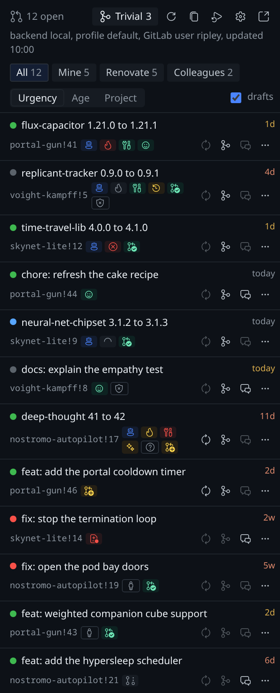
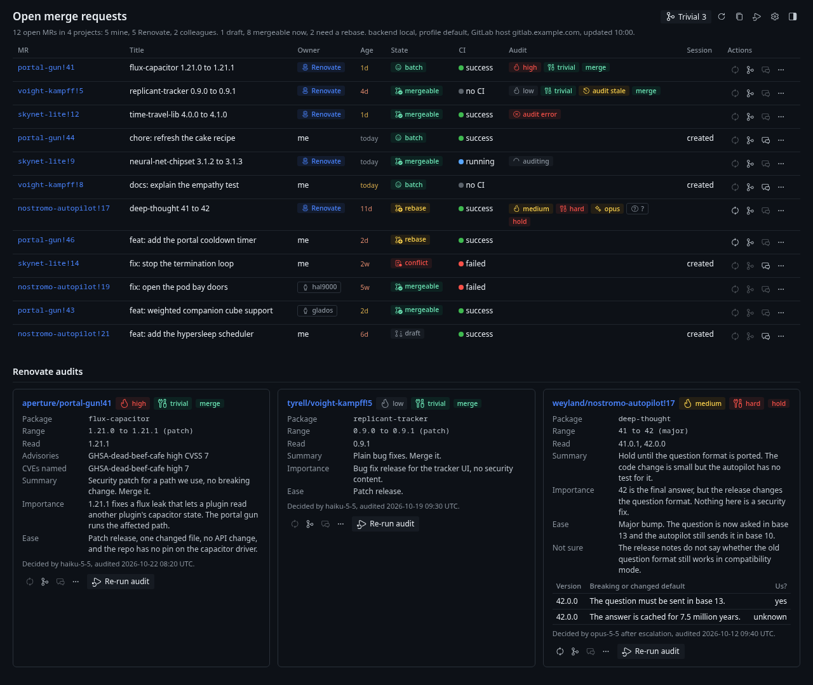

# Getting started

This walks you from nothing to your first merge request list on screen, with a look at each part
of the pane. It takes about ten minutes and needs Hermes Agent 0.21.5 or newer with Hermes
Desktop, and `glab` logged in to your GitLab host. Nothing here writes to GitLab.

## 1. Check glab

```sh
glab auth status --hostname <your-gitlab-host>
```

Mergeable runs `glab api` as you, so it sees exactly the projects you are a member of. It stores
and reads no token itself.

## 2. Install the plugin

```sh
hermes plugins install Senci/hermes-mergeable --enable
```

Hermes copies the package into `~/.hermes/plugins/mergeable/` and enables it for the current
profile. The desktop half arrives in `~/.hermes/desktop-plugins/mergeable/` when Hermes Desktop
next resolves its plugin root.

## 3. Switch on the desktop half

In Hermes Desktop open **Capabilities > Plugins** and switch on **Mergeable**. The desktop half
of every plugin package starts switched off, and the backend switch from step 2 does not cover
it. If the backend was running before step 2, restart it (or quit and reopen the app) so the
routes under `/api/plugins/mergeable/` mount.

## 4. Open the pane

Press `mod+alt+m` (Ctrl+Alt+M on Linux and Windows, Cmd+Option+M on macOS), or click the sidebar
row **Mergeable**, or run "Show Mergeable" from the command palette. The pane is a tab beside
Files and Review; the first load asks GitLab for every project, so the first answer takes a few
seconds and later ones are served from a cache.



From the top:

- **Header.** The count of shown MRs, then `Trivial (N)`, Refresh, Copy status, Re-audit all,
  the settings cog and a link to the full page. The line under it names the backend, the profile
  and the GitLab user, and when the list was built.
- **Filter chips.** All, Mine, Renovate and Colleagues with their counts, then the sort (Urgency,
  Age, Project) and a drafts checkbox.
- **Rows.** The first line is the pipeline dot, the title and the age. The second is the MR
  reference, the state chips and four icon buttons: Rebase, Merge, Open session and More. A click
  on the row opens a detail block.

Hover a chip: in the pane it is icon only, and the tooltip carries its name and the reason. The
list of icons is in [reference/chips-and-icons.md](../reference/chips-and-icons.md).

## 5. Read the colours

The age in the top right of a row is calendar time. Its colour counts working days (Monday to
Friday minus Hamburg public holidays): amber from 1 working day, orange from 3. Both limits are
settings. The tooltip names the date, the calendar days and the working days.

## 6. Open the full page

Click the link icon in the header. The page at `/mergeable` shows the same list as a table with
icon and label chips, and one audit card per audited Renovate MR below it.



## 7. Try a read-only action

Click **Copy status** and paste anywhere: you get the open MRs as Markdown, grouped by project.
Click the **More** button (three dots) on a row to see the menu: Open in GitLab, Open pipeline,
Copy branch name and the rest. Items that do not apply to the MR are disabled and say why.

## Where to go next

- Merge a first MR: [how-to/merge-one-mr.md](../how-to/merge-one-mr.md).
- Land several small MRs in one go: [how-to/land-trivial-batch.md](../how-to/land-trivial-batch.md).
- Change what counts as trivial, or switch notifications on and off:
  [how-to/settings-and-notifications.md](../how-to/settings-and-notifications.md).

## If the pane says it cannot reach the backend

The empty state names the backend and profile it asked. A 404 `Plugin not found` on a remote
gateway means that machine lacks the plugin, not that your local install is broken. On the local
device it usually means the backend started before the plugin was enabled: restart it.

## If you hid the tab

The tab only hides: it has no close button, so the plugin stays on. Bring it back from the tab
menu of the Files zone or with Ctrl+K and "Mergeable". Ctrl+J folds the whole Files zone with it.
